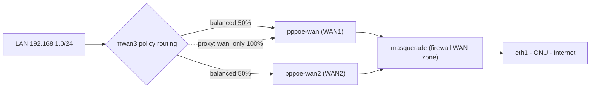

<div align="center">

# 🌐 OpenWrt Dual PPPoE Load Balancing & Failover

**Two PPPoE sessions. One ONU. One Ethernet uplink. Balanced and fault-tolerant.**

A practical guide for running **two PPPoE sessions over a single ONU / Ethernet uplink** on OpenWrt using `mwan3`.

<br>

[](https://openwrt.org/)
[](https://github.com/openwrt/packages/tree/master/net/mwan3)
[](#-1-network-topology)
[](LICENSE)

[](https://github.com/itachi-re/openwrt-dual-pppoe-mwan3/commits)
[](https://github.com/itachi-re/openwrt-dual-pppoe-mwan3/stargazers)
[](https://github.com/itachi-re/openwrt-dual-pppoe-mwan3/network/members)
[](https://github.com/itachi-re/openwrt-dual-pppoe-mwan3/issues)
[](https://github.com/itachi-re/openwrt-dual-pppoe-mwan3/pulls)


<br>

[Quick start](#-4-quick-start) •
[Verification](#-5-verification) •
[Failover](#-8-failover) •
[Troubleshooting](#-10-troubleshooting)

</div>

---

## ✨ Features

| | Feature | Details |
|---|---|---|
| ⚖️ | **50/50 load balancing** | Connection-based distribution across both PPPoE sessions |
| 🔁 | **Automatic failover** | WAN1 down → WAN2 carries 100%, restored automatically |
| 🔌 | **One physical link** | Independent PPPoE sessions over the same `eth1` |
| 🛡️ | **Proper IPv4 NAT** | Masquerading for both WANs via the firewall WAN zone |
| 🧭 | **Policy-based routing** | Per-destination rules with `mwan3` policies |
| 📌 | **WAN-pinned proxy** | Keep a specific proxy/server on a fixed public route |
| 🧪 | **Verification scripts** | One-shot health check and live per-WAN throughput monitor |

> [!IMPORTANT]
> This configuration performs **connection-based** load balancing. It does **not** combine two WANs into a single TCP connection. Applications must open multiple connections to benefit from both links at the same time.

> [!TIP]
> Tested on **OpenWrt 25.12.x** with `mwan3`.

---

## 📑 Table of contents

1. [Network topology](#-1-network-topology)
2. [Repository layout](#-2-repository-layout)
3. [Requirements](#-3-requirements)
4. [Quick start](#-4-quick-start)
5. [Verification](#-5-verification)
6. [Bandwidth expectations](#-6-bandwidth-expectations)
7. [Monitoring WAN traffic](#-7-monitoring-wan-traffic)
8. [Failover](#-8-failover)
9. [Pinning a proxy to one WAN](#-9-pinning-a-proxy-to-one-wan)
10. [Troubleshooting](#-10-troubleshooting)
11. [Result and limitations](#-11-result-and-limitations)

---

## 🗺️ 1. Network topology

```text
                         ┌──────────────────────┐
                         │         ONU          │
                         │    ISP Ethernet      │
                         └──────────┬───────────┘
                                    │
                                  eth1
                                    │
                         ┌──────────▼───────────┐
                         │       OpenWrt        │
                         │                      │
                         │        mwan3         │
                         │       50 / 50        │
                         └───────┬──────┬───────┘
                                 │      │
                      PPPoE WAN1 │      │ PPPoE WAN2
                                 │      │
                          ~350 Mbps    ~350 Mbps
                                 │      │
                                 └──┬───┘
                                    │
                                Internet
```

Both PPPoE sessions use the same physical interface:

```text
eth1
 ├── pppoe-wan
 └── pppoe-wan2
```

This is valid because PPPoE creates separate logical sessions over the same Ethernet link.

### 🔀 Traffic flow



---

## 📁 2. Repository layout

```text
.
├── README.md
├── config/
│   ├── network.example      # two PPPoE interfaces on eth1
│   ├── mwan3.example        # members, policies, rules, tracking
│   └── firewall.example     # adding wan2 to the WAN zone
├── scripts/
│   ├── apply-firewall-fix.sh   # adds wan2 to the firewall WAN zone
│   ├── verify.sh               # one-shot health check
│   └── monitor-wan-traffic.sh  # live per-WAN throughput
└── docs/
    └── troubleshooting.md
```

---

## 📋 3. Requirements

- [x] OpenWrt 25.12.x
- [x] Two working PPPoE accounts
- [x] Both accounts available through the same ONU/uplink
- [x] `mwan3`
- [ ] `luci-app-mwan3` (optional)
- [x] IPv4 routing

Install:

```sh
apk update
apk add mwan3 luci-app-mwan3
```

---

## 🚀 4. Quick start

### Step 1: Configure the two PPPoE interfaces

The first connection is the normal WAN, the second uses the same physical device:

```text
wan   → device: eth1, protocol: PPPoE, IPv4 enabled
wan2  → device: eth1, protocol: PPPoE, IPv4 enabled
```

See [`config/network.example`](config/network.example):

```uci
config interface 'wan'
        option device 'eth1'
        option proto 'pppoe'
        option username 'YOUR_PPPoE_USERNAME'
        option password 'YOUR_PPPoE_PASSWORD'
        option ipv6 'auto'
        option multipath 'off'

config interface 'wan2'
        option device 'eth1'
        option proto 'pppoe'
        option username 'YOUR_SECOND_PPPoE_USERNAME'
        option password 'YOUR_SECOND_PPPoE_PASSWORD'
        option ipv6 '0'
        option metric '20'
        option multipath 'off'
```

> [!WARNING]
> Never commit real PPPoE credentials to GitHub. Use placeholders, or keep credentials in an ignored local file (this repo's `.gitignore` already ignores `*.local` and `*.secret`).

### Step 2: Verify both PPPoE sessions

```sh
ifstatus wan
ifstatus wan2
```

Expected logical devices:

```text
pppoe-wan
pppoe-wan2
```

Each session gets its own address and peer:

```text
WAN1: 10.x.x.x/32  peer 172.x.x.x
WAN2: 10.x.x.x/32  peer 172.x.x.x
```

Check the routing table:

```sh
ip route
```

You should see two default routes:

```text
default via <peer> dev pppoe-wan
default via <peer> dev pppoe-wan2 metric 20
```

### Step 3: Configure mwan3

The key concept:

```text
WAN1 → member metric 1, weight 1
WAN2 → member metric 1, weight 1
```

Equal metrics and equal weights give approximately **WAN1 = 50% / WAN2 = 50%**.

Full example: [`config/mwan3.example`](config/mwan3.example). The essentials:

<details>
<summary><b>📄 Show the mwan3 essentials (/etc/config/mwan3)</b></summary>

```uci
config interface 'wan'
        option enabled '1'
        option family 'ipv4'
        option reliability '2'
        list track_ip '1.0.0.1'
        list track_ip '1.1.1.1'
        list track_ip '208.67.222.222'
        list track_ip '208.67.220.220'

config interface 'wan2'
        option enabled '1'
        option family 'ipv4'
        option reliability '2'
        list track_ip '1.0.0.1'
        list track_ip '1.1.1.1'
        list track_ip '208.67.222.222'
        list track_ip '208.67.220.220'

config member 'wan_m1_w1'
        option interface 'wan'
        option metric '1'
        option weight '1'

config member 'wan2_m1_w1'
        option interface 'wan2'
        option metric '1'
        option weight '1'

config policy 'balanced'
        list use_member 'wan_m1_w1'
        list use_member 'wan2_m1_w1'

config policy 'wan_only'
        list use_member 'wan_m1_w1'

config rule 'default_rule_v4'
        option dest_ip '0.0.0.0/0'
        option use_policy 'balanced'
        option family 'ipv4'
```

</details>

### Step 4: Add `wan2` to the firewall WAN zone (critical)

> [!IMPORTANT]
> Without this step, mwan3 will mark and route traffic to WAN2 correctly, but LAN traffic leaving through `pppoe-wan2` is **not masqueraded** and fails. See [docs/troubleshooting.md](docs/troubleshooting.md#the-critical-firewall-problem) for the full story.

```sh
uci add_list firewall.@zone[1].network='wan2'
uci commit firewall
/etc/init.d/firewall reload
```

> [!NOTE]
> `@zone[1]` assumes the WAN zone is the second zone in `/etc/config/firewall` (the OpenWrt default). Confirm with `uci show firewall | grep 'zone.*name'`, or use [`scripts/apply-firewall-fix.sh`](scripts/apply-firewall-fix.sh), which finds the zone by name.

Verify:

```sh
uci show firewall | grep -E 'zone.*name|zone.*network|zone.*masq'
```

Expected:

```text
firewall.@zone[0].name='lan'
firewall.@zone[0].network='lan'

firewall.@zone[1].name='wan'
firewall.@zone[1].network='wan' 'wan6' 'wan2'
firewall.@zone[1].masq='1'
```

The generated firewall4 rules should now include both `pppoe-wan` and `pppoe-wan2` in the WAN zone, and the NAT chain should contain:

```text
oifname { "eth1", "pppoe-wan", "pppoe-wan2" } jump srcnat_wan
```

with:

```text
meta nfproto ipv4 masquerade
```

### Step 5: Restart mwan3

On this OpenWrt/mwan3 version the correct command is:

```sh
mwan3 restart
```

Not `mwan3 reload`.

```sh
mwan3 status
```

Expected:

```text
interface wan is online and tracking is active
interface wan2 is online and tracking is active

balanced:
    wan2 (50%)
    wan  (50%)

wan_only:
    wan (100%)
```

---

## ✅ 5. Verification

You can run everything below in one go with [`scripts/verify.sh`](scripts/verify.sh).

### Policy routing

```sh
# WAN1
ip route get 1.1.1.1 mark 0x100
# expected: 1.1.1.1 via <peer> dev pppoe-wan table 1

# WAN2
ip route get 1.1.1.1 mark 0x500
# expected: 1.1.1.1 via <peer> dev pppoe-wan2 table 5
```

This confirms mwan3 has functional routing tables for both links.

> [!NOTE]
> The mark (`0x100`, `0x500`) and table number (`1`, `5`) depend on the **order of interfaces in `/etc/config/mwan3`**. In the stock config `wan2` ends up fifth, hence `0x500` / table 5. Check yours with `ip rule` and adjust.

### WAN2 direct connectivity

```sh
ping -I pppoe-wan2 -c 3 1.1.1.1
```

```text
3 packets transmitted, 3 packets received, 0% packet loss
```

Success confirms the second PPPoE session itself has Internet access.

### Connection-based load balancing

From a **LAN client**:

```sh
for i in $(seq 1 20); do
    curl -4 -s --max-time 5 https://api.ipify.org
    echo
done
```

<details>
<summary><b>👀 Example output</b></summary>

The results should vary across the ISP's public/NAT addresses, for example:

```text
203.0.113.102
203.0.113.101
203.0.113.101
203.0.113.97
203.0.113.103
203.0.113.99
203.0.113.101
203.0.113.97
...
```

This shows independent connections being distributed across the multi-WAN setup.

</details>

---

## 📊 6. Bandwidth expectations

> [!CAUTION]
> This setup is **not bonding**. mwan3 does not turn 350 Mbps + 350 Mbps into 700 Mbps for one TCP connection.

```text
Connection 1 ──→ WAN1
Connection 2 ──→ WAN2
Connection 3 ──→ WAN1
Connection 4 ──→ WAN2
Connection 5 ──→ WAN1
...
```

| Scenario | Path | Throughput |
|---|---|---|
| **Single connection** | One TCP flow → one WAN | ~350 Mbps max |
| **Multiple connections** | Flow 1 → WAN1, Flow 2 → WAN2 | ~700 Mbps aggregate |

Actual aggregate speed depends on:

- Speedtest server
- Application concurrency
- ISP shaping
- TCP behavior
- Router CPU
- PPPoE overhead
- Server-side limits

---

## 📈 7. Monitoring WAN traffic

OpenWrt exposes byte counters per PPPoE interface. This is more reliable than an application's displayed download speed.

```sh
sh scripts/monitor-wan-traffic.sh          # live Mbit/s per WAN
sh scripts/monitor-wan-traffic.sh -r       # raw byte counters
```

<details>
<summary><b>🧰 One-liner version</b></summary>

```sh
while true; do
    printf '%s  WAN1 RX=%-14s TX=%-14s | WAN2 RX=%-14s TX=%-14s\n' \
      "$(date '+%H:%M:%S')" \
      "$(cat /sys/class/net/pppoe-wan/statistics/rx_bytes)" \
      "$(cat /sys/class/net/pppoe-wan/statistics/tx_bytes)" \
      "$(cat /sys/class/net/pppoe-wan2/statistics/rx_bytes)" \
      "$(cat /sys/class/net/pppoe-wan2/statistics/tx_bytes)"
    sleep 1
done
```

</details>

---

## 🔁 8. Failover

The same configuration provides automatic failover:

```text
WAN1 goes offline
   ↓
mwan3 removes WAN1 from the balanced policy
   ↓
WAN2 carries 100%
```

Test it:

```sh
ifdown wan
sleep 8
mwan3 status
```

Expected:

```text
wan  disabled / tracking paused
wan2 online / tracking active

balanced:
    wan2 (100%)
```

New LAN connections continue through WAN2. Restore WAN1:

```sh
ifup wan
sleep 8
mwan3 status
```

Expected:

```text
wan  online
wan2 online

balanced:
    wan2 (50%)
    wan  (50%)
```

### ⚠️ Failover behavior to expect

mwan3 does connection-based routing, so an **existing TCP session breaks when its WAN disappears**:

```text
TCP session → WAN1 → WAN1 fails → existing session dies
```

A **new** connection then uses WAN2:

```text
New TCP session → WAN2 → Internet
```

This is expected. mwan3 is not a TCP connection migration or bonding system.

---

## 📌 9. Pinning a proxy to one WAN

A proxy can have its own mwan3 policy:

```uci
config rule 'proxy_server'
        option dest_ip 'YOUR_PROXY_IP'
        option dest_port '1080'
        option proto 'tcp'
        option use_policy 'wan_only'
```

where `wan_only` maps to WAN1:

```text
                     ┌── WAN1
                     │
Normal LAN traffic ──┤   (50/50)
                     │
                     └── WAN2

Proxy traffic ───────────→ WAN1 only
```

> [!IMPORTANT]
> mwan3 evaluates rules **top to bottom**. Put `proxy_server` **above** `default_rule_v4` in `/etc/config/mwan3`, otherwise the default rule matches first and the proxy is balanced like everything else.

This is useful when a specific proxy/server must always originate from the same public route. Do not publish real proxy credentials or private addresses.

---

## 🛠️ 10. Troubleshooting

See [docs/troubleshooting.md](docs/troubleshooting.md) for the full checklist. Quick run:

```sh
sh scripts/verify.sh
```

<details>
<summary><b>🩺 Quick symptom guide</b></summary>

| Symptom | Likely cause | Fix |
|---|---|---|
| WAN2 pings work, LAN traffic via WAN2 fails | `wan2` missing from the firewall WAN zone | [Step 4](#step-4-add-wan2-to-the-firewall-wan-zone-critical) |
| Proxy gets balanced across both WANs | `proxy_server` rule is below `default_rule_v4` | [Section 9](#-9-pinning-a-proxy-to-one-wan) |
| `ip route get ... mark 0x500` shows the wrong table | Interface order differs in your mwan3 config | Check `ip rule` and adjust |
| `mwan3 reload` does nothing useful | Wrong command for this version | Use `mwan3 restart` |

</details>

---

## 🏁 11. Result and limitations

**✅ Working**

- Two simultaneous PPPoE sessions over one ONU/uplink
- ~350 Mbps per PPPoE account
- 50/50 IPv4 connection-based load balancing
- Automatic failover
- WAN2 masquerading/NAT
- Policy-based routing
- WAN1-only proxy policy
- Verified multi-WAN connectivity from LAN

**⚠️ Limitations**

- A single TCP/UDP flow is still limited to one WAN.
- Aggregate bandwidth depends on the application creating multiple concurrent flows.
- Existing connections generally do not migrate between WANs during failover.
- Only IPv4 is load-balanced; IPv6 stays on `wan`.

---

## 🤝 Contributing

Issues and pull requests are welcome, especially for:

- Different ISPs and ONU models
- Other OpenWrt releases
- Additional verification and monitoring tooling

## 📄 License

Released under the [MIT License](LICENSE).

---

<div align="center">

**If this guide saved you time, consider giving it a ⭐**

</div>
